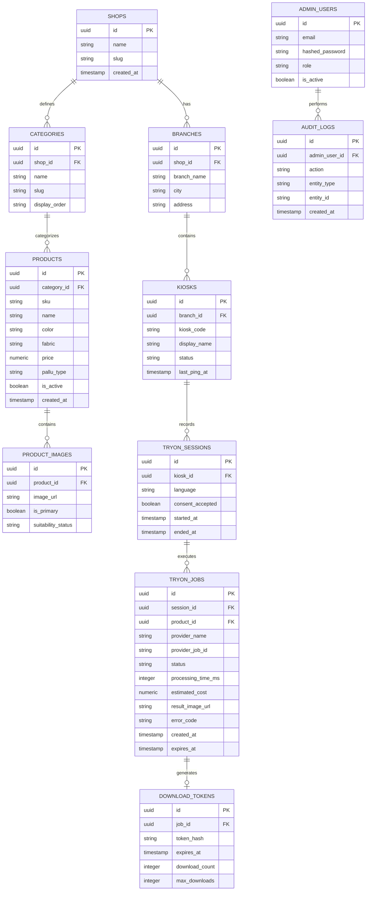

# Database Design — NeXooAi Virtual Saree Try-On

## 1. Relational Schema Overview

The database design uses normalized PostgreSQL entities (with SQLite compatibility for rapid local development).

## 2. Retention & Privacy Constraints
- Customer input photos and intermediate representations are marked with an `expires_at` timestamp (default: 24 hours, configurable via `MEDIA_RETENTION_HOURS`).
- Download tokens expire after 30 minutes (`DOWNLOAD_TOKEN_EXPIRY_MINUTES`).
- A background cron/retention worker deletes customer images from storage once their session expires.
